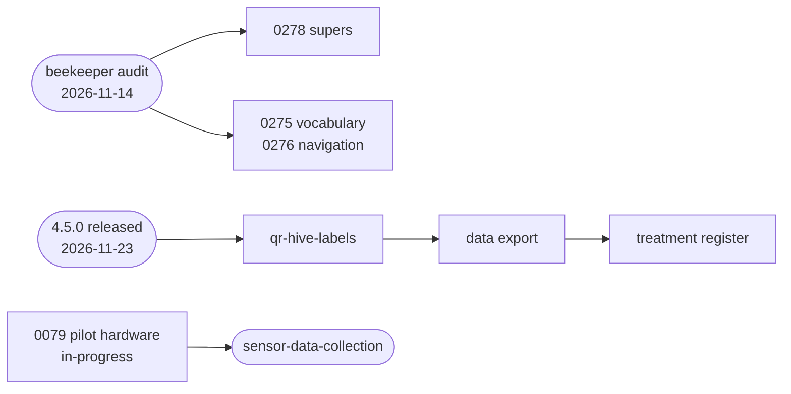

# 🐝 Hivelog Roadmap
A living roadmap derived from the projects, tasks, decisions, and releases in
this vault. Sequencing is driven by dependencies and completed work rather than
fixed dates. Last refreshed **2026-11-23**.
## Where things stand
276 tasks: **210 done**, 1 in-progress, 1 review, 1 todo, 49 backlog, 10
deferred, 4 dropped. 28 projects: **11 done**, 4 active, **11 planning**, 1
backlog, 1 dropped. 50 decisions: 48 accepted, 2 proposed
([[0083-ai-assisted-apiary-insights]], [[0109-entitlement-interface-commerce-gating]]).
The latest release is **4.5.0** (2026-11-23, not yet applied on hvg); 4.4.1 is the one applied on the hvg site. HiveLog
is hosted and tested on hvg (`hivelog.eu`); see AGENTS.md.
Since the last refresh (2.4.0, 2026-10-04) the module went through three major
versions. The market-survey work and the November audit
([[2026-11-14-beekeeper-domain-audit]]) fed the planned projects below.
## Release timeline
### ✅ Released since 2.4.0
Each has its own note in `releases/`.
- **2.5.0–2.8.1** (2026-10-04): calendar actions, action logs and the financial
  report made discoverable ([[2.5.0]]); validation moved onto the entities
  ([[2.6.0]]); the new optional **`hivelog_api`** submodule, a per-user OAuth
  JSON:API for field apps ([[2.7.0]], ADR-0107), with computed views
  ([[2.8.0]]).
- **2.9.0–2.13.0** (2026-10-05 to 10-15): the API for the **Vinculum** iOS app:
  sign-out ([[2.9.0]]), filtering and the schema endpoint ([[2.10.0]]), writes
  through a host firewall ([[2.11.0]]), insights and hive tints ([[2.12.0]]),
  editing and deleting ([[2.13.0]]).
- **[[3.0.0]]** (2026-10-26, major): **apiary roles**. Every member has a role
  (novice, beekeeper, owner) and access comes from that membership alone
  (ADR-0108). Followed by UI polish ([[3.1.0]]), friendly 404 and 403 pages
  ([[3.2.0]]), collapsing filters on a phone ([[3.3.0]]), the hive autocomplete
  naming its apiary ([[3.4.0]]), a simpler nav strip ([[3.5.0]]) and linked
  finance pages ([[3.6.0]]).
- **[[4.0.0]]** (2026-10-30, major): the field-app API moves to the versioned
  `/api/v1` prefix; a site can choose the prefix its pages use. [[4.1.0]]
  adds discovery details for the app.
- **[[4.2.0]]** (2026-11-11): choose or copy an apiary's seasonal calendar.
  **[[4.3.0]]** (2026-11-13): apiary page tweaks. **[[4.4.0]]** (2026-11-16):
  harvest consolidation ([[0110-one-harvest-record-plan-and-fact]]) and
  calendar weeks shown as dates.
- **[[4.4.1]]** (2026-11-22): one-off **hive reminders** (task 0274: entity,
  hive page section, Needs attention alerts, a Next visit field on the
  inspection form, cascade delete with the hive) and the repair of the build
  the first attempt broke. Beekeeper roles on hvg have been granted the
  reminder permissions.
- **[[4.5.0]]** (2026-11-23): a **quick inspection** mode, frames of bees and brood, several disease signs (task 0279;
  the v1 `disease_signs` attribute is now a list) and the queen noted from the inspection form (tasks 0294 and 0295,
  ADR-0111). Not yet applied on hvg.
## Active projects
- **[[sensor-data-collection]]** — the software chain ships; what is left is
  physical. [[0079-pilot-weight-sensor-hardware-build]] is `in-progress`.
  Backlog: [[0096-off-grid-gateway-power-design]],
  [[0115-varroa-camera-sensor-hardware-build]].
- **[[seasonal-calendar-and-hive-action-tracking]]** — all tasks done, the
  umbrella [[0026-post-testing-refinements]] closed 2026-11-23; the project can be marked `done`.
- **[[inventory-and-yield-improvements]]** — 7 backlog tasks, all `low`
  ([[0046-real-sales-ledger]], [[0047-cross-apiary-aggregate-views]],
  [[0048-unit-conversion]], [[0050-fifo-lot-costing]],
  [[0051-expected-unit-price-audit-trail]],
  [[0052-merge-usage-and-yield-form-traits]],
  [[0053-product-category-field]]). The sales ledger is the one that would
  unlock true profitability.
- **[[ai-apiary-insights]]** — shipped across `collective`, `nexus` and the
  dashboard. [[0094-ai-insights-prelaunch-validation]] remains in backlog and
  is the gate before pointing this at real beekeepers.
## Planning projects
Any task that adds an entity or changes access starts with an ADR task, and
the tasks after it depend on that ADR.
- **[[beekeeper-centred-simplification-and-gaps]]** (from the 2026-11-14
  audit; the largest source of near-term work). Tasks 0269–0274, 0277, 0279 and 0283–0288
  are done (ended hives, harvest without a calendar action, starter products,
  inspection-lapse alerts, reminders, dates for weeks, the one harvest
  record). Open: [[0275-plain-language-vocabulary]],
  [[0276-navigation-by-beekeeper-job]],
  [[0278-supers-one-source-of-truth]],
  [[0280-queen-and-colony-acquisition-cost-in-reports]],
  [[0281-queen-end-reason-and-marking]], [[0282-hive-type-and-material-lists]]
  and [[0289-fix-pre-existing-phpcs-warnings-and-errors]].
- **[[ios-field-app]]** (now `active`) — the app lives in its own repository (Vinculum); the
  tasks here that moved there are `deferred`. Open here: the demo-site kit
  [[0215-demo-site-kit]] (`review`).
  [[0235-keep-the-nested-demo-site-out-of-module-discovery]] is done: the per-site setting stays, now documented.
- **[[qr-hive-labels]]** (high) — [[0177-hive-quick-access-page]] →
  [[0178-printable-qr-label-sheet]]. The app's scanning is done in Vinculum;
  the web page and label sheet are not built.
- **[[data-export-and-printable-records]]** (high) —
  [[0174-collection-csv-export]], [[0175-printable-hive-record]],
  [[0176-apiary-export-bundle]].
- **[[treatment-register]]** (high) — [[0182-treatment-register-adr]] →
  [[0183-treatment-entity-and-ui]] → [[0185-treatment-register-report]];
  [[0184-varroa-trend-and-threshold-alert]] can start straight away.
- **[[sensor-event-detection]]** (medium) — [[0195-weight-step-change-detection]]
  → [[0196-sensor-event-alerts-and-confirmation]]; [[0197-hive-opened-detection]].
  Tune against real data from [[0079-pilot-weight-sensor-hardware-build]].
- **[[weather-aware-inspection-planning]]** (medium) —
  [[0179-weather-forecast-adr-and-client]] → [[0180-inspection-window-panel]],
  [[0181-inspection-weather-snapshot]]. Sends apiary coordinates to a third
  party, so it is opt-in.
- **[[colony-lifecycle-events]]** (medium) — [[0186-colony-lifecycle-adr]] →
  [[0187-colony-event-entity-and-timeline]], [[0188-hive-lineage-and-moves]].
- **[[honey-sales-and-batch-provenance]]** (low) —
  [[0192-sales-and-batch-adr]] → [[0193-honey-batch-entity]] →
  [[0194-public-batch-provenance-page]].
- **[[shared-apiaries-and-team-roles]]** (now `active`) — Layer 2 (roles) shipped in 3.0.0. Left: [[0230-inspection-records-items-used]]
  and the entitlement tasks [[0225-hivelog-entitlement-interface]],
  [[0226-hivecount-quota-enforcement]].
- **[[hivelog-commerce-submodule]]** — [[0227-hivelog-commerce-submodule-repo]]
  (a separate repository; no core dependency on commerce), after
  [[0109-entitlement-interface-commerce-gating]] is accepted.
## Backlog project
**[[hive-log-frontend-polish]]** — reviewed 2026-11-22 against the code.
[[0253-hive-page-operational-dashboard]] was dropped (superseded by the
stat-tile work, tasks 0256–0259). Still wanted, trimmed:
[[0250-beeswax-theme-warm-palette]], [[0251-inspection-list-grouping]],
[[0252-sensor-charts-improved]], [[0254-empty-state-improvement]] (the empty
states of 0251 fold into 0254).
## Completed projects
[[mobile-ux-improvements]], [[action-button-consistency]],
[[breadcrumb-consistency]], [[page-structure-consistency]],
[[dashboard-landing-page]], [[hivelog-visual-identity]],
[[inventory-tracking-and-depreciation]],
[[honey-wax-propolis-yield-and-potential-income]],
[[in-app-navigation-restructuring]], [[hive-component-weight-tracking]] and
[[collection-page-filter-coverage]] are all `done`.
## Dropped projects
**[[queen-observation-enhancements]]**, 2026-09-26. Its only undelivered goal
(CSV export) was judged unnecessary and dropped.
## Decision gate
**48 accepted · 2 proposed.** Nothing blocks execution.
[[0083-ai-assisted-apiary-insights]], an under-specified umbrella, has been
overtaken in practice ([[0100-nexus-in-process-ai-synthesis]] records it as
partially superseded): worth deciding whether it should read `superseded`.
[[0109-entitlement-interface-commerce-gating]] is the gate for the commerce
tasks.
## Unassigned tasks
Two backlog tasks belong to no project: [[0003-apiary-map-marker-clustering]]
and [[0055-embed-required-items-and-expected-yield-in-calendar-action-edit-form]].
## Recommended sequence
1. [[0278-supers-one-source-of-truth]] (unblocked by ADR-0111), then the two other medium
   tasks of the audit project ([[0275-plain-language-vocabulary]],
   [[0276-navigation-by-beekeeper-job]]). 4.5.0 shipped 0279 (a breaking v1 change
   to `disease_signs`, for the unreleased app).
2. Build one shared empty-state helper ([[0254-empty-state-improvement]],
   with the empty states of 0251).
3. Start [[qr-hive-labels]] (web page and label sheet), the smallest of the
   high-priority survey projects, then [[data-export-and-printable-records]]
   and [[treatment-register]].
4. Housekeeping: decide
   [[0083-ai-assisted-apiary-insights]]; run [[0094-ai-insights-prelaunch-validation]] before any
   real-world AI rollout.
5. Pick up [[inventory-and-yield-improvements]] only when a real need surfaces;
   every item there is `low` and speculative.
6. Later: [[sensor-event-detection]], [[weather-aware-inspection-planning]],
   [[colony-lifecycle-events]], [[honey-sales-and-batch-provenance]] and
   [[hivelog-commerce-submodule]].
## Current state

## Live snapshot — open tasks by project
```dataview
TABLE status, priority, project
FROM #hivelog/task
WHERE status != "done" AND status != "dropped"
SORT project asc, file.name asc
```
## Related
- Dashboard: [[index]]
- Conventions: [[README]]
